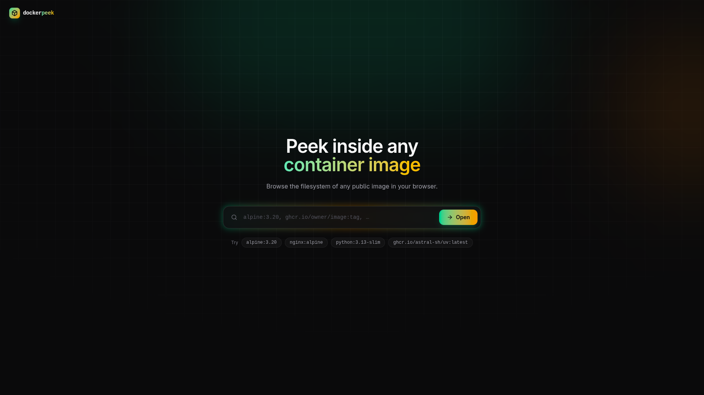
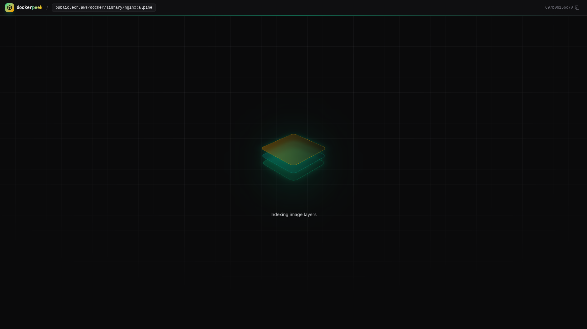

# dockerpeek

Browse the filesystem of any public container image in your browser, without pulling it.

**Live:** https://dockerpeek.nivekithan.com





## Development

```sh
pnpm install
pnpm dev
```

Web runs on http://localhost:5173 and the API on http://localhost:5174.

```sh
pnpm exec vp run check   # format, lint, and type check
pnpm build
```

## Deployment

Pushes to `main` deploy the API and web Workers to Cloudflare through GitHub Actions.
